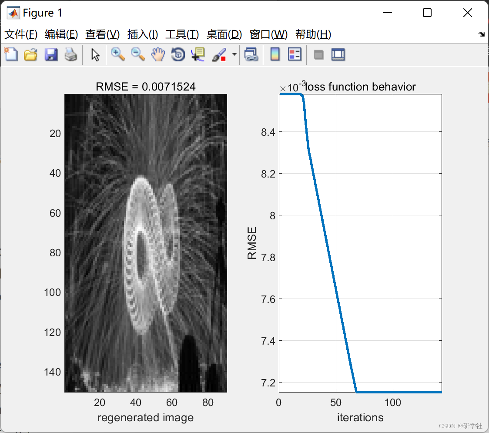

# Regular Autoencoder Training Based on PSO (Matlab Code Implementation)

💥💥💞💞 Welcome to this blog❤️❤️💥💥
🏆 Bloggers' Advantage: 🌞🌞🌞 The content of the blog strives to be rigorous in thought and clear in logic, for the convenience of readers.
⛳️ Mantra: "Those who travel a hundred miles may arrive at the ninety-ninth mile." 📜
💥1 Overview This paper trains a conventional autoencoder using PSO, one of the most famous random search algorithms in optimization. Here, we will not elaborate further.
📚2 Running Results Editing
Part of the code:
clear all;  
clc;  
addpath('NEW_PSO','AE');  
%% data preparation  
original=imread('tu_pian.png');  
original=imresize(original,[150,90]);  
x=rgb2gray(original);  
Inputs=double(x);  
%% network initialization  
number_neurons=89;% number of neurons  
LB=-10;     % lower bands of weights  
UB=10;      % upperbands of weights  
n=10;      % number of population  
%% training process  
[net]=PSO_AE(Inputs,number_neurons,LB,UB,n);  
%% Illustration  
regenerated=net.code*pinv(net.B');  
subplot(121)  
imagesc(regenerated);  
colormap(gray);  
Tc=num2str(net.prefomance);  
Tc= ['RMSE = ' Tc];  
xlabel('regenerated image')  
title(Tc)  
subplot(122)  
plot(smooth(net.errors,52),'LineWidth',2);  
xlabel('iterations')  
ylabel('RMSE')  
title('loss function behavior')  
axis([0 length(net.errors) min(net.errors) max(net.errors)])  
grid  
function[net]=PSO_AE(Inputs,number_neurons,LB,UB,n)  
% PSO_AE:this function trains an auto-encoder based random search tool (PSO).  
% number_neurons:number of neurons in hidden layer.  
% Inputs: the training set.  
% LB: Lower band constraints for the weights  
% LB: Lower band constraints for the weights  
% n : number of population (in PSO).  
% net: this variable contains the important Characteristics of training  
Inputs = scaledata(Inputs,0,1);% data Normalization  
alpha=size(Inputs);  
% Initialize the PSO parameters  
m=number_neurons*alpha(2);  
LB=ones(1,m)*(LB);  
UB=ones(1,m)*(UB);  
% Solving Optimization problem based on random search  
[Fvalue,B,nb_iterations,fit_behavior]=PSO(m,n,LB,UB,Inputs,number_neurons);%  
% prepare the problem solution  
B=reshape(B,number_neurons,alpha(2));  
% calculate the Inputs_hat : Unlike other networks the AEs uses the same weight  
% beta as an input weigth for coding and output weights for decoding  
% we will no longer use the old input weights:input_weights.  
Hnew=Inputs*B';     % the hidden layer  
Inputs_hat=Hnew*pinv(B');% the estimated Input  
% store the network Characteristics  
net.errors=fit_behavior;% the training loss function behavior  
net.prefomance=sqrt(mse(Inputs-Inputs_hat));% the training preformance  
net.B=B;% the reconstructio weights  
net.code=Hnew;% the training hidden layer  
end  
🎉3 References
[2] Y. Liu, B. He, D. Dong, Y. Shen, and T. Yan, "ROS-ELM: A Robust Online Sequential Extreme Learning Machine for Big Data Analytics," Proc. ELM-2014 Vol. 1, Algorthims Theor., vol. 3, pp. 325–344, 2015.  
[3] H. Zhou, G.-B. Huang, Z. Lin, H. Wang, and Y. C. Soh, "Stacked Extreme Learning Machines.," IEEE Trans. Cybern., vol. PP, no. 99, p. 1, 2014.  
[4] Lu Qiang, Teng Jinfeng, Li Jie, Ling Liang, Ding Chao, Huang Jianggang. Time Series Prediction Mixed Model Based on Autoencoder [J]. Computer Systems and Applications, 2022, 31(7):55-65  
🌈4 Matlab Code Implementation

## Images

<!-- PAYMENT_BLOCK -->

## Get this dataset

- Payment link (Stripe): [Buy now](https://buy.stripe.com/3cs8yP7sY87d0vu9AB)
- Payment QR code: 

<!-- /PAYMENT_BLOCK -->
